# Replicated Map

Replicated maps provide a mechanism for sharing data across a fleet of
microservices.

## Overview

Pulse replicated maps leverage Redis hashes and pub/sub to maintain replicated
in-memory copies of a map across multiple nodes. Any change to the map is
automatically replicated to all nodes and results in a notification that can be
used to trigger actions.

Upon joining a replicated map the node receives an up-to-date snapshot of its
content. The replicated map then guarantees that any change to the map results
in a notification.

## Usage

### Creating a Replicated Map

To create a replicated map you must provide a name and a Redis client. The name
is used to namespace the Redis keys and pub/sub channels used by the map. The
map should later be closed to free up resources.

[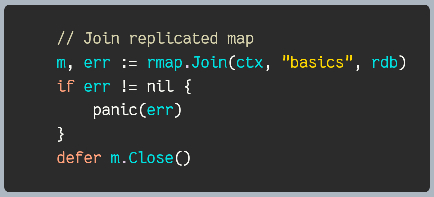](../examples/rmap/basics/main.go#L24-L29)

The `Join` function creates a new replicated map or joins an existing one.  The
`Close` function closes the subscription channels and the subscription to Redis.

### Retention (TTL)

By default, replicated maps do not expire. Pulse can optionally set a TTL on the
Redis hash backing a map:

- `rmap.WithTTL(ttl)` sets an **absolute TTL** (set once when the hash is first
  created and never extended).
- `rmap.WithSlidingTTL(ttl)` sets a **sliding TTL** (refreshed on every write).

When the hash expires, the map's data is gone from Redis. The next write starts
a new *generation* of the map, and every replica that receives a change from a
generation it does not hold reloads the map from Redis, so no replica keeps
serving the expired data once the map is written again. `Sync` also empties a
replica's copy when it finds the map expired.

### Upgrading and rolling back

Every write stamps the map's Redis hash with a generation (`=gen`) and each
published change carries it. Processes that share a replicated map, including
the `pool` and `streaming` packages, which write map hashes from their own
scripts, must all run a Pulse version with the same format:

* **Upgrade every process together.** Stop every process that uses a given map,
  deploy the new version everywhere, then start them. An older process cannot
  decode the new change format, and if it loads the map it shows `=gen` as if
  it were an entry.
* **Rolling back your application** while keeping this Pulse version needs no
  extra step.
* **Downgrading Pulse** requires stopping every process that runs the newer
  version first, then removing the generation field from each map before an
  older version starts: `HDEL map:<name>:content =gen`. This removes only the
  field and keeps the map's entries. Starting older processes alone is not
  enough, because the field stays in Redis.

### Writing to the Map

* The `Set` method sets the value for a given key and returns the previous value. 

[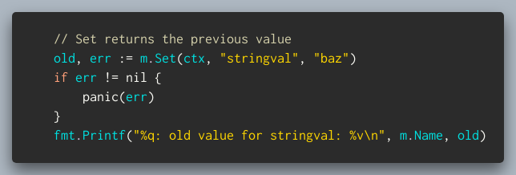](../examples/rmap/basics/main.go#L41-L46)

* The `TestAndSet` method sets the value for a given key if the current value
  matches the expected value. It returns the previous value.

* The `AppendValues` and `RemoveValues` methods append or remove values to or from a list. 

[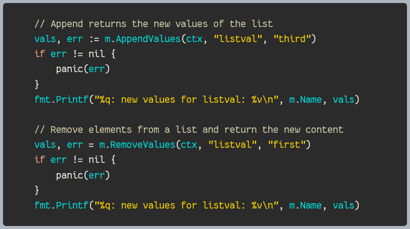](../examples/rmap/basics/main.go#L60-L72)

Values are stored as strings. The list helpers store list values as JSON arrays
so appends, uniqueness checks, and removals can round-trip without losing item
boundaries.

* The `Inc` method increments a counter by a given amount and returns the new value.

[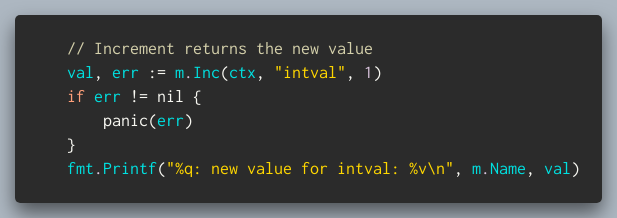](../examples/rmap/basics/main.go#L79-L84)

* The `Delete` method deletes a key from the map and returns the previous value if any.

[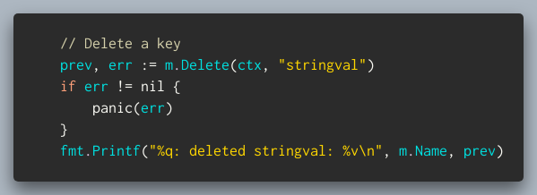](../examples/rmap/basics/main.go#L48-L53)

* Finally `Reset` clears the entire map.

[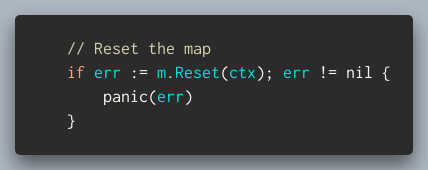](../examples/rmap/basics/main.go#L31-L34)

### Reading from the Map

* The `Get` method retrieves the value associated with a specified key and
  returns both the value itself and a boolean flag indicating whether the value
  exists in the map.

[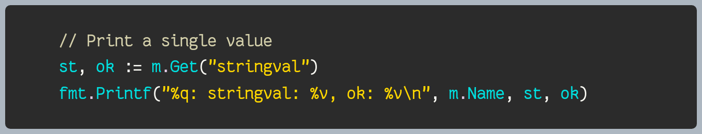](../examples/rmap/basics/main.go#L86-L88)

* The `Keys` method returns a list of all the keys in the map.

[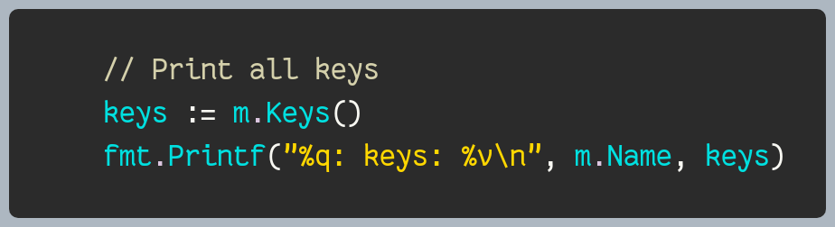](../examples/rmap/basics/main.go#L90-L92)

* The `Len` method returns the number of keys in the map.

[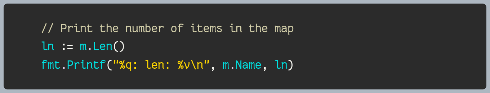](../examples/rmap/basics/main.go#L94-L96)

* The `Map` method returns a snapshot of the current key-value pairs in the map.

[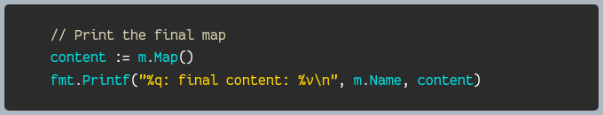](../examples/rmap/basics/main.go#L98-100)

#### Reading after writes made elsewhere

`Get`, `GetValues`, `Keys`, `Len`, and `Map` read the replica's in-memory copy,
so they cost no network call. Each replica applies changes as Redis
broadcasts them, which means a write that has just completed through *another*
process may not be in this copy yet. Two methods order reads after writes:

* `Sync` reads the whole map from Redis once and replaces the local copy when
  Redis holds newer data, so the reads that follow include every write that
  completed before the call, wherever it was made. Call it before a read that
  must reflect an earlier request handled by a different process:

```go
// The previous request saved the user's settings through another replica.
if err := m.Sync(ctx); err != nil {
    return err
}
settings, _ := m.Get("settings:" + userID) // includes that save
```

* `SetAndWait` is `Set` followed by `Sync`, so the writer's own reads that
  follow see its write.

`Sync` does not stop other processes from writing to Redis, so a write that is
still in progress when it is called may or may not be included. Each call reads
the whole map, so use it where the freshness matters rather than before every
read.

Replicas also recover on their own: when the Redis connection drops, go-redis
reconnects and resubscribes, and the replica then reloads the map, because
changes published while it was disconnected were never delivered.

### Subscribing to Map Updates

* The `Subscribe` method returns a channel that can be used to receive notifications
  when the map is updated. The channel is closed when the map is closed.

[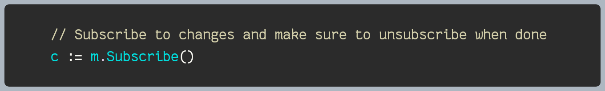](../examples/rmap/basics/main.go#L102-L03)

When a replica reloads its whole copy from Redis (after missing changes, after
the map expired, or on `Sync`), it sends one notification for the reload.
That notification is `EventReset` whenever the copy changed generation or
skipped more than one change, because the entries that changed are not known;
read the map again with `Map`, `Get`, or `Keys` to see the current content.

> **Note:** Notifications do not include any information about the change that
> triggered them. The application must query the map to retrieve the current
> state. Multiple updates may result in a single notification however it is
> guaranteed that the map is in the latest state when the notification is
> received.

* The `Unsubscribe` method unsubscribes from map updates. It also closes the
  subscription channel.

[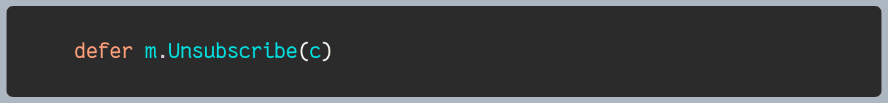](../examples/rmap/basics/main.go#L104)

## When to Use Replicated Maps

Replicated maps being stored in memory are not suitable for large data sets. They
are also better suited for read-heavy workloads as reads are local but writes
require a roundtrip to Redis.

A good use case for replicated maps is metadata or configuration information that
is shared across a fleet of microservices. For example a replicated map can be
used to share the list of active users across a fleet of microservices. The
microservices can then use the replicated map to check if a user is active
without having to query a database.

## Examples

The [examples/rmap](../examples/rmap) directory contains a few examples that
demonstrate the basic usage of the `rmap` package.
